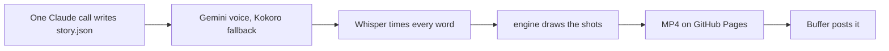

# Untold Files

Short, true, little-known stories, three a day (09:00, 14:00 and 19:00 India time), drawn in a flat illustrated style and posted automatically to Instagram (and YouTube,
Facebook and X if you add them in Buffer).



## What it costs

- **Claude:** one call per video (about 15-30k tokens), on your Claude Pro or Max subscription. A second call only
  if the first story fails the checks.
- **Everything else is free:** Gemini voice (free tier), Kokoro and Whisper run locally, GitHub Actions and Pages,
  Buffer's free plan.

## How a video is made

- `brand/topics.json`: the categories (war, mystery, India, disaster, invention, unbelievable, survival, ancient).
  The least recently used one is picked each day.
- `prompts/writer.md`: the rules Claude writes by: true and well-sourced stories, the hook, narration, captions,
  scenes. `story.schema.json` is the exact shape; `scripts/write.ts` checks the rest and never repeats a story.
- `engine/src/shots.js`: the scene library Claude chooses from (headline card, date ribbon, map with routes, people in 13 roles, 41 objects,
  counts, timeline) and the end card. All drawn in code.
- `brand/example-story.json`: a finished example.

## Setup

1. **Secrets** (already set if they were in the old repo; check under Settings → Secrets):
   ```bash
   claude setup-token
   gh secret set CLAUDE_CODE_OAUTH_TOKEN
   gh secret set GEMINI_API_KEY
   gh secret set BUFFER_API_KEY_1
   ```
2. **Pages:** Settings → Pages → Source: **GitHub Actions**.
3. **Instagram in Buffer:** connect the new Instagram account in Buffer, put the key in `.env` as
   `BUFFER_API_KEY_1=...`, run `npm run post -- --channels` and paste only the Untold Files channels into
   `brand/channels.json`.
4. **Test:** `gh workflow run daily.yml -f test=true`. The video and a contact sheet are attached to the run.
5. **Go live:**
   ```bash
   gh variable set DAILY --body on      # make a video every morning
   gh variable set POSTING --body on    # post it (leave off for the first week and check each video)
   ```

## Locally

```bash
npm ci
bash ~/Downloads/faceless-shorts/scripts/setup.sh   # Python tools, Kokoro and Whisper (once)
npm run make -- brand/example-story.json            # render the example to out/
npm run daily -- --test                             # write and render the next slot's story
```
