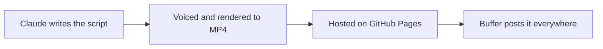

# Reel Autopilot

Posts one short video a day for your product to Instagram, YouTube, Facebook and X, with no one in the loop.

<p align="center"></p>



Every morning a GitHub Action asks Claude Code for a new idea, checks it, voices it, renders it
and schedules it. Everything about your product lives in `brand/`. The example there is
[Random Talker](https://randomtalker.com).

## Cost

Only your **Claude Pro or Max subscription**. Everything else runs on free tiers: Gemini voice
(with Piper as the fallback), GitHub Actions and Pages, and Buffer.

**Claude usage per video:** 2–6 short calls (one to write, one to review, repeated if a draft is weak),
about **20–50k tokens** in under 2 minutes. Most of that is cached prompt, which counts lightly
against your limits. Roughly one short Claude Code chat a day, well within Pro.
No API key or per-token bill. The Actions log shows the exact tokens for each call.

Remotion needs a [paid licence](https://www.remotion.dev/license) for companies of more than 3 people.

## Setup

1. **Use this template** on GitHub to create a public repo, then clone it and run `npm ci`.
2. **Add secrets.**
   ```bash
   claude setup-token                      # copy the token it prints
   gh secret set CLAUDE_CODE_OAUTH_TOKEN
   gh secret set BUFFER_API_KEY_1          # Buffer → Settings → API
   gh secret set GEMINI_API_KEY            # optional for voice over ( recommended ) , from aistudio.google.com
   ```
3. **Turn on Pages:** Settings → Pages → Source: **GitHub Actions**.
4. **Find your channels:** put the Buffer key in `.env` as `BUFFER_API_KEY_1=...`, then run
   `npm run post -- --channels` and paste the output into `brand/channels.json`.
5. **Describe your product** in `brand/`:
   - `brand.json`: name, site, colours, logo, posting time
   - `brief.md`: facts, tone, what never to claim
   - `angles.json`: themes to rotate through

   Then clear the example's history:
   `rm -f reels/20*.json data/posts/*.json && echo '[]' > data/history.json`
6. **Test it:** `gh workflow run daily.yml -f test=true`, then watch the run in Actions.
7. **Go live:**
   ```bash
   gh variable set DAILY --body on      # make a video every morning
   gh variable set POSTING --body on    # post it
   ```

## Everyday

- **Preview scenes:** `npm run stills`
- **Pause posting:** `gh variable delete POSTING`
- **Post now:** Actions → Daily reel → Run workflow → tick **post_now**

If a run fails, GitHub opens an issue.

## If something breaks

- **401 / auth error:** the Claude token expired (it lasts about a year). Run `claude setup-token`
  again and update the secret.
- **Gemini 429 or 402:** quota or billing problem. Videos fall back to the Piper voice automatically.
- **Post failed:** reconnect the channel in Buffer, then run `npm run post -- <date>`.

## License

MIT for the code (`LICENSE`). Remotion and the bundled assets have their own terms (`NOTICE.md`): fonts are OFL, avatars CC0. The Random Talker logo, clips and game art are
examples only (see `brand/ASSETS.md`).
